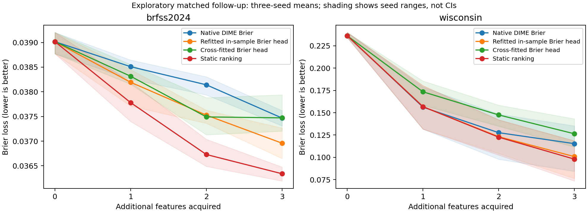

# Matched DIME follow-up — 19 October 2026

## Result and decision

This development follow-up does not support promoting the cross-fitted Brier value head as an improvement. At least one declared seed shows worse Brier with an interval excluding zero. All seed-level outcomes are retained below. This is evidence about this bounded implementation, not proof that cross-fitting cannot help in other settings. Do not spend the untouched 2025 evaluation to confirm this version or describe it as a new acquisition algorithm.

## What was matched

Official DIME classes were executed at reference commit `06ba70f7bcd54dbd8ccd64bed398dfef90d09da5`. The original joint predictor/value optimization and training sampler were retained. Compatibility wrappers handle the removed torch scheduler `verbose` argument, NumPy `Inf` alias and scoped setuptools required by Lightning 1.9. The Brier variant uses binary Brier prediction loss and unconstrained value scaling; the CE reference retains entropy-bounded scaling. These changes are explicit adaptations, not published-score reproduction.

The primary comparison freezes the same full-data Brier-trained DIME predictor and refits either an in-sample or a three-fold out-of-fold value head. Both value heads have the same architecture, masks, episodes, optimizer, epochs, deployment predictor and evaluation records. Additional controls include fold-size-matched in-sample teachers, post-loss regression, native joint value heads, static and random policies. Cross-fitting uses more teacher-fitting compute. Fold teachers train on less data than the deployment model.

Each fold fits its own preprocessing, excludes every held-out respondent episode, and uses the same separate stopping partition. Reference pretraining and joint training each run 15 epochs; checkpoints are selected by validation mean loss. Value heads use 25 fixed epochs. No probability recalibration or hyperparameter search was performed.

| Dataset | Fit | Stopping | Development evaluation | Evaluation positives |
|---|---:|---:|---:|---:|
| brfss2024 | 6000 | 1500 | 1500 | 62 |
| wisconsin | 318 | 80 | 171 | 64 |

BRFSS is a complete-case sample from the existing fit/stop/select partitions. Sex and age are initially observed. Wisconsin starts with no features and uses a stopping subset drawn from its original fitting partition. Its outcome is diagnostic malignancy, not incident disease. Neither is a new confirmatory cohort. BRFSS 2024 final-test, 2023 transport and 2025 records were not evaluated.

## Brier loss after three acquisitions

Lower is better. Means across three initialization seeds; not independent-cohort averages. CE uses its own jointly trained predictor; all other rows share the full Brier predictor. Native and offline value heads have different state-training distributions, so their comparison concerns complete policy procedures rather than target estimation alone.

| Policy | BRFSS 2024 development | Wisconsin diagnostic |
|---|---:|---:|
| Native DIME CE | 0.037499 | 0.121739 |
| Native DIME Brier | 0.037468 | 0.115356 |
| Refitted in-sample Brier head | 0.036958 | 0.100848 |
| Cross-fitted Brier head | 0.037471 | 0.126413 |
| Same-size in-sample teachers | 0.036936 | 0.125280 |
| Cross-fitted post-loss head | 0.037954 | 0.120846 |
| Static ranking | 0.036339 | 0.098007 |
| Random | 0.037905 | 0.155122 |

## Primary paired comparison

Benefit = refitted in-sample Brier minus cross-fitted Brier after exactly three acquisitions. Positive favors cross-fitting. Intervals use 500 paired IID record bootstraps, conditional on each fitted model; they do not account for training randomness or BRFSS survey design.

| Dataset | Seed | Benefit | 95% conditional record interval |
|---|---:|---:|---|
| brfss2024 | 42 | -0.000673 | [-0.001759, +0.000398] |
| brfss2024 | 43 | -0.000310 | [-0.001603, +0.000776] |
| brfss2024 | 44 | -0.000556 | [-0.001784, +0.000607] |
| wisconsin | 42 | -0.048194 | [-0.067015, -0.030707] |
| wisconsin | 43 | -0.024687 | [-0.036259, -0.011021] |
| wisconsin | 44 | -0.003813 | [-0.009788, +0.002990] |

## Identical-state diagnostics

All policies are queried on exactly the same independently seeded partial-information states. Candidate features already observed are excluded. This resolves the earlier pilot’s trajectory-comparison limitation. Value MSE compares predicted and realized one-step benefits from the same frozen full Brier predictor. It contains irreducible outcome noise, so it is not a pure calibration metric; signed bias, predicted-versus-realized quantile-bin means, and the realized benefit of selected actions are also saved.

| Dataset | Seed | Same-state CF delta/post-loss action agreement | In-sample value MSE | CF value MSE |
|---|---:|---:|---:|---:|
| brfss2024 | 42 | 0.143 | 0.000138 | 0.000135 |
| brfss2024 | 43 | 0.081 | 0.000122 | 0.000126 |
| brfss2024 | 44 | 0.118 | 0.000187 | 0.000180 |
| wisconsin | 42 | 0.298 | 0.003457 | 0.004259 |
| wisconsin | 43 | 0.538 | 0.001660 | 0.002003 |
| wisconsin | 44 | 0.187 | 0.002044 | 0.002381 |



## Practical limits and next gate

The small diagnostic dataset and 62 stroke-history positives in BRFSS evaluation limit precision. There is no natural-missingness evaluation, survey-design inference, clinical utility validation or fresh-year confirmation. Masked-feature simulation is not evidence of a clinically useful questionnaire: stroke history is directly askable. Reference training begins with no observed features; BRFSS evaluation and offline value-head masks start with sex and age. The reference learns paths up to five acquisitions, whereas offline value heads use random partial states. These protocol differences are disclosed, and only the two refitted value heads form the primary matched comparison.

Do not infer an algorithmic contribution from a favorable single seed or metric. The cross-fitting improvement claim remains unsupported by these two development pilots. A defensible next research decision is whether an empirical study of action-value generalization has enough explanatory evidence to justify a broader benchmark. Before expanding, require a specific failure mechanism and matched learning/data-size/teacher-alignment controls. If the goal remains clinical stroke-risk prediction, a longitudinal or independently measured endpoint is required; BRFSS cannot supply that evidence.

Checkpoints, fitted preprocessors, respondent positions, prediction arrays and training logs are saved in the ignored run directory. Aggregate results and source/version protocol are tracked in `docs/experiments/dime_matched/`. The runner refuses output-directory reuse and writes the protocol before fitting.

## Reproduction

Install `requirements-dime-pilot.txt` and clone the pinned DIME reference. For Lightning 1.9, put a scoped setuptools 80.9 installation first on PYTHONPATH, as in the earlier execution-check instructions.

```bash
PYTHONPATH=/path/to/dime-compat OMP_NUM_THREADS=2 OPENBLAS_NUM_THREADS=2 MKL_NUM_THREADS=2 python -m truststroke.dime_matched --data /path/to/brfss2024_selected_raw.csv --reference /path/to/DIME --output results/new-matched
python -m truststroke.report_dime_matched --run results/new-matched --output docs/experiments/new-matched
```

Validation: full unit suite executed with new binary-Brier reduction, gradient and logit-shift checks; see validation record for counts. No new test-set tuning or conference-publication claim.


## Post-hoc teacher/deployment diagnostic

No models were refitted for this check. Restored fold checkpoints and the full deployment checkpoint were evaluated at the same partial-information states. In Wisconsin, cross-fitted value estimates fit the **average fold-teacher realized utility** better than the in-sample value head in all three seeds (CF MSE approximately 0.000148–0.000169 versus 0.000465–0.000906), yet fit the **full deployment predictor utility** worse in all three. Fold-teacher versus full-predictor utility RMSE was approximately 0.0382–0.0584. Candidate-centered utility drift was also substantial (RMSE 0.0323–0.0479), so the difference is not just a common baseline-loss offset.

This is consistent with a teacher/deployment target mismatch contributing to the failure on that small dataset. It is a post-hoc explanation, not proof of causation: fold training uses fewer records, different initializations and its own validation-selected checkpoint. Averaging teacher utility also reduces noise and is not the same object as the utility of a probability-averaged ensemble. BRFSS teacher/full utility RMSE was 0.00618–0.00782, and CF utility MSE was mixed; this diagnostic does not establish a single explanation for both datasets.

The implication is specific: out-of-fold target estimation is not automatically an acquisition improvement when the policy is deployed with a different predictor. A possible future experiment would align teacher and deployment procedures and match sample size and compute. Such an experiment needs a separate protocol and novelty assessment; it is not added as a favorable post-hoc variant here.

Final validation: 27 unit tests ran, 25 passed and two optional TabNet tests were skipped. All 192 saved-prediction Brier values agree with the aggregate curves; six seed runs completed, split disjointness was checked, and the executed source hash matches the protocol. Model/preprocessor/value-head restoration was verified by a new round-trip test.
