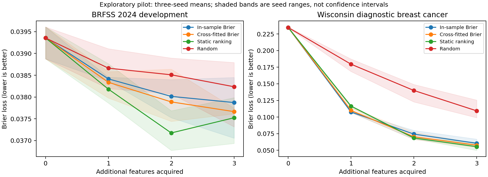

# DIME target-estimation pilot — 19 October 2026

## Decision

The bounded development pilot **does not establish a cross-fitting advantage**. Do not claim a new acquisition algorithm or spend the untouched 2025 evaluation on this version. Retain the null/mixed result and use it to narrow the next research decision.

The uploaded novelty audit identified DIME, Gadgil, Covert & Lee, ICLR 2024, as a direct precursor. The official source was cloned at `06ba70f7bcd54dbd8ccd64bed398dfef90d09da5`; `dime/cmi_estimator.py` confirms joint predictor/value optimization and regression against before-minus-after loss. Cross-fitting changes target estimation, not that underlying objective. Same-record training is not automatically held-out test leakage, and the direction of bias in a difference of two losses is not known in advance.

## What ran

`truststroke.dime_pilot` is a **fixed-predictor DIME-style adaptation**, not an implementation of the entire official joint algorithm and not a reproduction of published scores. All variants share the same full-fit masked MLP during evaluation. Predictor training uses cross-entropy; its targets may be CE or binary Brier loss. There is no post-hoc probability calibration in this first pilot.

- Real BRFSS 2024: 6,000 complete-case fitting respondents, 264 stroke-history positives; 1,500 complete-case selection/development respondents, 62 positives. Existing split seed 42; fixed subsampling seed 2026. No new 2024 final-test or 2023 evaluation; no 2025 loading.
- Real Wisconsin diagnostic breast-cancer data distributed with scikit-learn: 398 fitting and 171 evaluation records, 148 and 64 malignant cases respectively. Positive class explicitly inverted to malignancy. This is an auxiliary real tabular dataset, not an official DIME benchmark, prospective outcome, or clinical acquisition validation.
- Three initialization seeds: 42, 43, 44. Identical respondent splits across seeds.
- Predictor: masked values plus original-variable indicators; 64/32 ReLU MLP, 30 epochs, AdamW, no tuning. Each fold fits its own preprocessing. BRFSS categoricals are one-hot encoded and acquired as whole questions.
- Three random states per fitting respondent, with up to five optional observed features. Value MLP: 64/32 ReLU, 25 epochs. Targets are not clipped; missing/observed states cannot expose hidden values to the networks.
- BRFSS starts with sex and age observed; Wisconsin starts with no features. Equal unit costs; evaluate zero through three added features. These are declared simulations, not measured monetary costs or burden estimates.
- Three-fold out-of-fold teachers exclude every episode of the held-out respondent. The deployment predictor uses all fitting records. This teacher/deployment difference remains an important limitation.

Controls: full-data in-sample Brier targets; cross-fitted Brier targets; same-size in-sample teachers (each trained on two-thirds of respondents); cross-fitted post-loss targets; full-data in-sample CE targets; a split-sample teacher/value control; random acquisition; static mean training loss-improvement ranking. The split control uses fewer distinct value-training respondents and is therefore diagnostic rather than a fully matched comparator.

## Results

Mean Brier loss after exactly three acquisitions; **lower is better**. Means across three seeds are descriptive, not independent-cohort replication.

| Fixed-predictor policy | BRFSS 2024 development | Wisconsin diagnostic breast cancer |
|---|---:|---:|
| In-sample Brier | 0.037873 | 0.060454 |
| Cross-fitted Brier | 0.037665 | 0.057578 |
| Same-size in-sample teacher | 0.037265 | 0.056071 |
| Cross-fitted post-loss regression | 0.038086 | 0.060578 |
| In-sample CE targets | 0.037356 | 0.061151 |
| Split-sample Brier | 0.038032 | 0.059903 |
| Random | 0.038236 | 0.109281 |
| Static ranking | 0.037524 | 0.055302 |

Cross-fitting's mean improvement over full-data in-sample targets is small and unstable. Static ranking has lower mean Brier than cross-fitting on both datasets; the same-size in-sample teacher also has lower mean Brier on both. No winner is adopted from these development observations.

Paired benefit = in-sample Brier minus cross-fitted Brier; positive favors cross-fitting. Intervals are 500-replicate paired IID record bootstraps conditional on each fitted model. They are not survey-design or training-uncertainty intervals.

| Dataset | Seed | Benefit | 95% record-bootstrap interval |
|---|---:|---:|---|
| BRFSS | 42 | +0.000370 | [-0.000959, +0.001777] |
| BRFSS | 43 | -0.000578 | [-0.001502, +0.000338] |
| BRFSS | 44 | +0.000834 | [-0.000359, +0.001978] |
| Wisconsin | 42 | +0.012622 | [-0.001602, +0.025985] |
| Wisconsin | 43 | -0.000917 | [-0.004942, +0.002457] |
| Wisconsin | 44 | -0.003078 | [-0.013229, +0.006919] |

Every interval crosses zero. This does not prove equivalence or that cross-fitting never helps; it means this pilot did not demonstrate the proposed effect.

Value calibration was checked on fixed random development states using held-out realized Brier improvements. Cross-fitting reduced value-target MSE in two of three seeds on BRFSS and one of three on Wisconsin; no consistent benefit was demonstrated. A single realized improvement is noisy, so its MSE is not a pure calibration measure: predicted-versus-realized five-bin means and signed biases are also saved. These diagnostics use the full deployment predictor, not fold teachers.

Cross-fitted improvement versus post-loss policies often choose different actions despite equivalent ideal rankings. Agreement over the three sequential steps was 6.5–11.9% on BRFSS and 0.2–44.1% on Wisconsin. States diverge after initial actions, so this is trajectory agreement, **not** a matched-state test of the population equivalence. It suggests substantial estimation/optimization differences; it is not evidence of a new decision objective.



Shading is the range across three seeds, not a confidence interval. The figure includes the primary comparison and simple controls; all eight policy curves and AP/AUROC are saved in aggregate JSON.

## Limits and next decision

This is a small, uncalibrated, complete-case development pilot. It does not test natural missingness, MNAR robustness, survey weighting, temporal transport, clinically meaningful questioning, formal power, full tuning budgets, or superiority to the official DIME algorithm. Complete-case selection changes the BRFSS population. The primary interval calculation does not model the complex survey design. Neural training histories/checkpoints for this adaptation were not retained; seeds, configuration, exact split positions and predictions were retained locally, along with aggregate metrics and the source hash.

Do not change a few hyperparameters until a favorable seed appears. Before any larger comparison, specify matched-state action/value diagnostics, independent stopping/calibration partitions, fold-teacher versus deployment-predictor alignment, learning-curve checks, and fair sample/compute controls. Run an established AFA benchmark with the official method before making a DIME improvement claim. Acquisition is a secondary hypothesis, not the established main contribution of the stroke project.

For a stroke-focused paper, the existing reliability audit remains a possible empirical direction, conditional on a sharper question and adequate validation. BRFSS identifies self-reported history; it does not validate future-stroke prediction. The target is directly askable, so simulated acquisition must be presented as a benchmark rather than clinical justification. If the project requires a clinical acquisition contribution, an independently measured or longitudinal endpoint is necessary.

## Reproduction and artifacts

```bash
OMP_NUM_THREADS=2 OPENBLAS_NUM_THREADS=2 MKL_NUM_THREADS=2 python -m truststroke.dime_pilot --data /path/to/brfss2024_selected_raw.csv --output results/new-dime-pilot
python -m truststroke.report_dime_pilot --run results/new-dime-pilot --output docs/experiments/new-dime-pilot
```

The runner refuses an existing output directory. `protocol.json` is written before model fitting. Aggregate records, seed-level curves, uncertainty intervals, value diagnostics and environment/source hash are in `docs/experiments/dime_pilot/`. Raw records, split positions, predictions and reference checkpoints remain outside tracked artifacts.

Validation: 24 unit tests ran: 22 passed and two optional TabNet tests were skipped in the refreshed runtime because pytorch-tabnet was not installed. Three new checks cover hidden-value isolation, mask eligibility and the sign of Brier benefits. Existing optional TabNet checks passed in the earlier recorded environment; they were not revalidated here.

## Official DIME execution check

The original `MaskingPretrainer`, `CMIEstimator` and `MaskLayer` classes completed real-data training for three seeds on Wisconsin diagnostic breast cancer. This is an official-class **execution check**, not replication of a published benchmark result. We retained the original joint CE training, bounded value scaling and evaluation masking. It starts with no observed features, uses a five-step training budget, and reports up to three acquired features.

A separate 20% validation subset was taken from the 398 fitting records; preprocessing was fitted only on the remaining training records. Each seed used 30 pretraining and 30 joint epochs, with the joint checkpoint selected by validation mean loss. Seed-level Brier at three acquisitions: 0.045399, 0.050198, 0.064287. These are not a matched comparison to the adaptation, which used all 398 fitting records without validation checkpoint selection and a different training objective/schedule.

The reference checkout remains unmodified. Compatibility was supplied in the wrapper: omit torch's removed scheduler `verbose` argument, retain the original pretraining scheduler monitor, supply Lightning 1.9's removed NumPy `Inf` alias, and use scoped setuptools 80.9 for `pkg_resources`. Earlier failed compatibility attempts preceded any joint evaluation; their causes are recorded in `official_compatibility.json`. Original training's repeated-feature sampling behavior was retained, not silently corrected.

Runner: `truststroke/dime_reference_check.py`. Reference commit is checked before imports. Aggregate results and compatibility provenance are in `docs/experiments/dime_pilot/official_execution.json` and `official_compatibility.json`. Checkpoints and prediction arrays remain in the ignored run directory.
